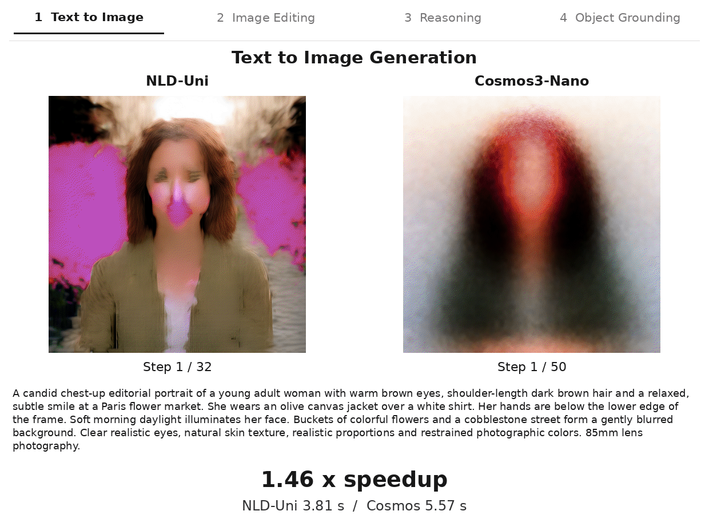

# Nemotron-Labs-Diffusion-Uni: Elastic Self-Refining Unified Diffusion LLM with Cross-Paradigm On-Policy Distillation



[Huggingface Checkpoint](https://huggingface.co/nvidia/NLD-Uni)

This is the official complementary codebase of NLD-Uni. It contains gradio demo, SGLang inference, and finetuning script of NLD-Uni. This codebase is not required for running the model. Huggingface checkpoint is standalone release and can be directly loaded and used in `transformers` library without cloning this Git repo.


## Environment

Requires an NVIDIA GPU, a compatible driver, and CUDA 12.6.

```bash
conda env create -f environment.yml
conda activate nlduni-inference
pip install --no-build-isolation flash-attn==2.8.0.post2
pip install -r requirements-gradio.txt
```

## Inference

```bash
python infer.py --task text-to-image --prompt "A mountain lake at sunrise." --output generated.png
python infer.py --task image-edit --image input.png --prompt "Add snow to the mountains." --output edited.png
python infer.py --task understand --image input.png --prompt "Describe this image."
python infer.py --task grounding --image input.png --prompt "dog, red collar" --output boxes.png
```

The default model is [nvidia/NLD-Uni](https://huggingface.co/nvidia/NLD-Uni). Use `--model /path/to/model` for a local download. Run `python infer.py --help` for options.

## Gradio demo

```bash
python gradio_demo.py --model nvidia/NLD-Uni
```

Open `http://127.0.0.1:7860`. Use `--host`, `--port`, or `--device` as needed.

## SGLang and training

- [SGLang setup and inference](sglang/README.md)
- [SFT and online OPD setup and training](minimal_training/README.md)

## License

This codebase and its artifacts are governed by [NVIDIA LICENSE](LICENSE)